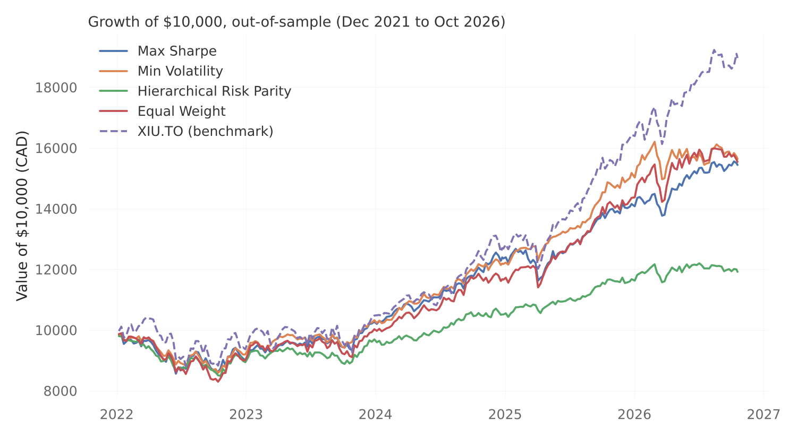
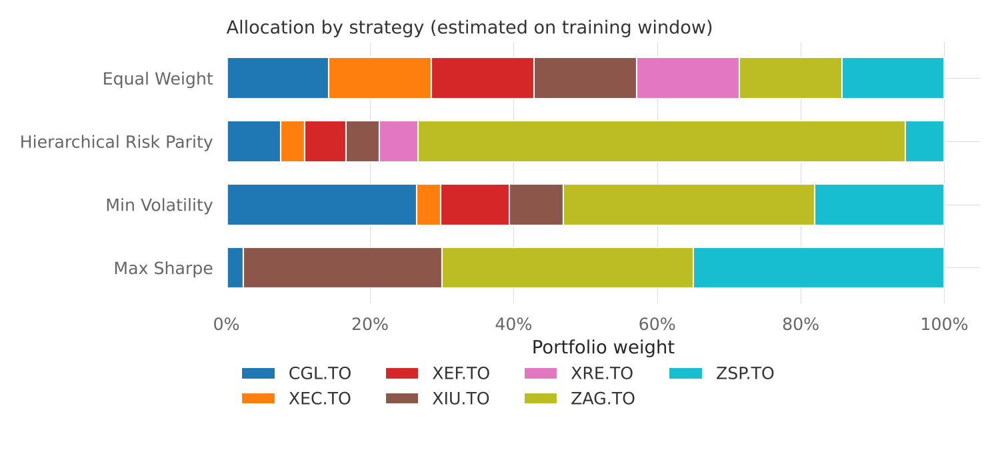

# Portfolio Performance Analyzer

Does portfolio optimization actually beat a simple index fund? This tool builds diversified portfolios of Canadian-listed ETFs with four different allocation methods, then tests them **out-of-sample** against the TSX 60, so the results reflect what an investor would really have experienced rather than hindsight.



## How it works

1. **Data:** weekly adjusted prices (dividends reinvested) for 7 ETFs covering Canadian, US, international and emerging market equities, Canadian bonds, REITs and gold
2. **Train / test split:** weights are estimated only on May 2013 to Dec 2021, then frozen and tested on Jan 2022 to Oct 2026. This avoids look-ahead bias, the most common mistake in backtests.
3. **Four strategies:**
   - **Max Sharpe:** the mean-variance portfolio with the best return per unit of risk
   - **Min Volatility:** the lowest-risk mix on the efficient frontier
   - **Hierarchical Risk Parity (HRP):** clusters correlated assets and spreads risk across clusters, without relying on return forecasts
   - **Equal Weight:** the naive 1/N baseline
4. **Risk controls:** Ledoit-Wolf shrinkage for a more stable covariance matrix, and a 35% cap on any single ETF for the mean-variance strategies
5. **Evaluation:** CAGR, volatility, Sharpe, Sortino, max drawdown and Calmar for each strategy, plus a full [QuantStats tearsheet](reports/tearsheet.html) for the best one

| ETF | Exposure |
|---|---|
| XIU.TO | Canada large cap (TSX 60), also the benchmark |
| ZSP.TO | US large cap (S&P 500) |
| XEF.TO | International developed markets |
| XEC.TO | Emerging markets |
| ZAG.TO | Canadian aggregate bonds |
| XRE.TO | Canadian REITs |
| CGL.TO | Gold (CAD hedged) |

## Results (Jan 2022 to Oct 2026, out-of-sample)

| Strategy | CAGR | Volatility | Sharpe | Max Drawdown |
|---|---|---|---|---|
| Max Sharpe | 9.4% | 9.1% | 0.71 | -14.4% |
| **Min Volatility** | **9.7%** | **8.2%** | **0.81** | **-14.1%** |
| Hierarchical Risk Parity | 3.7% | 6.8% | 0.13 | -15.1% |
| Equal Weight | 9.6% | 10.0% | 0.67 | -17.1% |
| XIU.TO (benchmark) | 14.2% | 12.7% | 0.88 | -15.4% |



## Key takeaways

- **The TSX 60 won on raw return** in this period, driven by a strong run in Canadian equities. No allocation estimated on 2013 to 2021 data anticipated it, which is exactly what an honest out-of-sample test should reveal.
- **Min Volatility delivered nearly the benchmark's Sharpe ratio (0.81 vs 0.88) with about a third less volatility** and a smaller drawdown, so it is the better choice for a risk-averse investor.
- **HRP underperformed because it put about two-thirds of the portfolio in bonds** right before the 2022 rate-hike cycle hit bond prices. Risk-based methods are only as good as the assumption that past volatility reflects future risk.
- **Equal weight was hard to beat.** The optimized portfolios only modestly improved on 1/N, a well-known result in portfolio research.

## Run it

```bash
pip install -r requirements.txt

# Live data from Yahoo Finance
python analyze.py

# Offline, using the bundled sample data
python analyze.py --csv data/weekly_prices_cad_etfs.csv

# Your own tickers, dates and constraints
python analyze.py --tickers VFV.TO XIC.TO XBB.TO --benchmark XIC.TO --split 2020-12-31 --max-weight 0.5
```

Outputs are written to `reports/`: weights, out-of-sample metrics, the growth chart, the allocation chart and an HTML tearsheet.

## Project structure

```
analyze.py                    Command-line entry point
portfolio_analyzer/
  data.py                     Loads prices from Yahoo Finance or a CSV
  optimize.py                 Builds the four portfolios with PyPortfolioOpt
  report.py                   Metrics, charts and the QuantStats tearsheet
data/                         Sample weekly price data
reports/                      Generated results
```

## Notes and limitations

- Portfolios are rebalanced to target weights every week and ignore trading costs and taxes.
- Results depend heavily on the chosen period; try different `--split` dates to see how stable the conclusions are.
- PyPortfolioOpt 1.6 crashes in HRP with SciPy 1.18 or newer ([upstream issue #754](https://github.com/PyPortfolio/PyPortfolioOpt/issues/754)). `optimize.py` includes a small documented workaround until a fixed release ships.
- Sample data: weekly adjusted closes from Alpha Vantage, included for reproducibility. This project is for learning and is not investment advice.

## Tech stack

Python · pandas · PyPortfolioOpt · QuantStats · yfinance · Matplotlib
